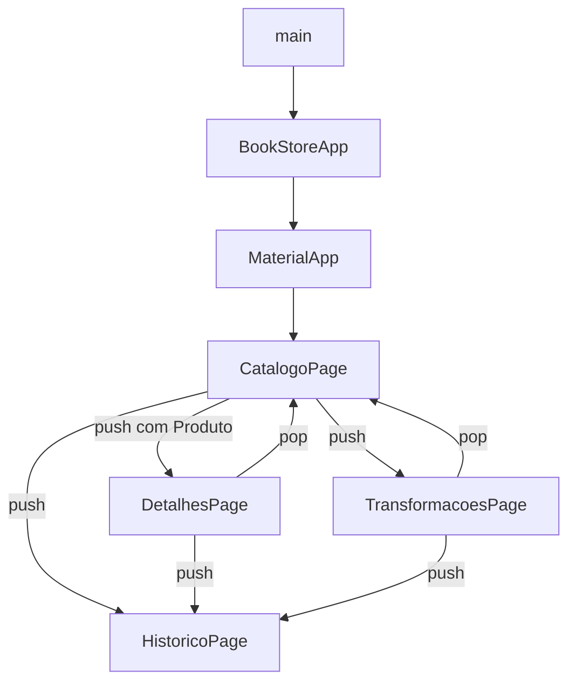
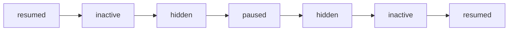

# BookStore — Guia de Estudos de Flutter e Dart

> **Material de revisão dos conceitos aplicados no projeto BookStore**, desenvolvido a partir da Aula 08 — *Android, navegação e ciclo de vida*.
>
> Este arquivo é um **guia de estudo**, não o README de instalação. Os exemplos reproduzem ou simplificam trechos do projeto para explicar seu funcionamento.

**Projeto:** BookStore — catálogo de livros  
**Linguagem:** Dart  
**Framework:** Flutter  
**Plataforma de testes:** Android  
**Conceitos centrais:** modelos de dados, widgets, `map()`, `toList()`, `Stack`, `Navigator`, ciclo de vida, `ValueNotifier` e callbacks.

---

## Como estudar este material

Para cada tópico:

1. Leia a explicação e identifique o conceito no `lib/main.dart`.
2. Tente explicar **por que** ele foi usado, não apenas o que ele faz.
3. Execute os exemplos ou pequenas modificações sugeridas.
4. Responda às questões ao final **antes** de consultar o gabarito.

### Sumário

1. [Visão geral do BookStore](#1-visão-geral-do-bookstore)
2. [Android nativo e Flutter](#2-android-nativo-e-flutter)
3. [Fundamentos de Dart utilizados](#3-fundamentos-de-dart-utilizados)
4. [Classes, construtores e o modelo Produto](#4-classes-construtores-e-o-modelo-produto)
5. [Árvore de widgets e construção de interfaces](#5-árvore-de-widgets-e-construção-de-interfaces)
6. [Listas, `map()` e `toList()`](#6-listas-map-e-tolist)
7. [Widgets gerados dinamicamente](#7-widgets-gerados-dinamicamente)
8. [Layout com Stack e Positioned](#8-layout-com-stack-e-positioned)
9. [Navegação com Navigator](#9-navegação-com-navigator)
10. [StatelessWidget, StatefulWidget e State](#10-statelesswidget-statefulwidget-e-state)
11. [Ciclo de vida do aplicativo](#11-ciclo-de-vida-do-aplicativo)
12. [Estado compartilhado com ValueNotifier](#12-estado-compartilhado-com-valuenotifier)
13. [Callbacks, closures e SnackBar](#13-callbacks-closures-e-snackbar)
14. [Testes observados no Android](#14-testes-observados-no-android)
15. [Erros e confusões frequentes](#15-erros-e-confusões-frequentes)
16. [Exercícios práticos](#16-exercícios-práticos)
17. [Questões de revisão e gabarito](#17-questões-de-revisão-e-gabarito)
18. [Glossário e referências](#18-glossário-e-referências)

---

## 1. Visão geral do BookStore

O aplicativo possui quatro telas:

| Tela | Responsabilidade | Conceitos principais |
| --- | --- | --- |
| `CatalogoPage` | Mostrar os três livros, preços e estoque | `ListView`, `Card`, `map()`, `toList()`, `Stack` |
| `DetalhesPage` | Exibir os dados completos do livro escolhido | Construtor, objeto `Produto`, `Navigator.push()` e `pop()` |
| `TransformacoesPage` | Demonstrar transformações de números, palavras e nomes | `List`, `map()`, `toList()`, `Text`, `Wrap`, `FilledButton`, `SnackBar` |
| `HistoricoPage` | Exibir estados reais recebidos do sistema | `AppLifecycleListener`, `ValueNotifier`, `ValueListenableBuilder` |

O `BookStoreApp` é o widget principal e guarda o monitoramento do ciclo de vida, compartilhando o mesmo histórico com as telas.



**Ideia central:** o **modelo** (`Produto`) representa os dados; os **widgets** exibem os dados; o **Navigator** organiza as telas; o **listener** observa o estado global do app.

### Três perguntas diferentes sobre “estado”

| Pergunta | Tipo de estado | Ferramenta |
| --- | --- | --- |
| O aplicativo está ativo ou em segundo plano? | Ciclo de vida do aplicativo | `AppLifecycleListener` |
| Qual página está no topo? | Navegação e histórico de rotas | `Navigator` |
| Qual produto foi escolhido? | Dados usados pela interface | Objeto `Produto`, construtores e estado local |

Esses conceitos **não são intercambiáveis**. Abrir outra página não significa necessariamente colocar o aplicativo em segundo plano.

---

## 2. Android nativo e Flutter

No Android, uma **Activity** hospeda uma interface e participa do ciclo de vida controlado pelo sistema operacional. O projeto Flutter costuma ter uma `MainActivity` que herda de `FlutterActivity`.

```kotlin
class MainActivity : FlutterActivity()
```

No Flutter, páginas como `CatalogoPage` e `DetalhesPage` são **widgets escritos em Dart**. Não é necessário criar uma nova Activity Android para cada tela.

Um **Fragment** é um componente da interface nativa do Android, hospedado por uma Activity ou outro Fragment. Ele não é equivalente a um widget Flutter.

| Responsabilidade | Android nativo | Flutter |
| --- | --- | --- |
| Hospedar a interface | Activity | `FlutterActivity` |
| Compor a interface | Views, Fragments ou Compose | Widgets |
| Navegar entre telas | Navigation/FragmentManager | `Navigator`/Router |
| Observar estado do app | Callbacks da Activity | `AppLifecycleListener` ou `WidgetsBindingObserver` |

**Para lembrar:** uma Activity pode hospedar várias telas Flutter. O sistema Android coordena o aplicativo; a árvore de widgets organiza a interface Flutter.

---

## 3. Fundamentos de Dart utilizados

### 3.1. Tipos mais presentes no projeto

```dart
String nome = 'Flutter Essencial';
double preco = 89.90;
int quantidade = 6;
bool disponivel = quantidade > 0;

List<int> numeros = [1, 2, 3, 4, 5];
List<String> palavras = ['Flutter', 'é', 'incrível'];
```

Dart possui **tipagem estática**: os tipos ajudam o analisador a encontrar incompatibilidades antes da execução.

### 3.2. `final` versus `const`

```dart
final agora = DateTime.now(); // Definido durante a execução.
const limite = 3;             // Constante conhecida em tempo de compilação.
```

- `final`: a variável só pode receber uma atribuição, mas o objeto referenciado pode ser mutável.
- `const`: indica um valor constante em tempo de compilação.

Exemplo de nuance importante:

```dart
final numeros = <int>[1, 2];
numeros.add(3); // Permitido: a lista continua mutável.
// numeros = [9]; // Não permitido: reatribuir a variável final.

const outros = <int>[1, 2];
// outros.add(3); // Não permitido: lista constante.
```

No BookStore, o `final historico` aponta sempre para o mesmo `ValueNotifier`, mas `historico.value` pode ser atualizado.

### 3.3. Interpolação de strings

```dart
final nome = 'Flutter Essencial';
final quantidade = 6;

print('Livro: $nome');
print('Estoque: ${quantidade + 1}');
```

- `$variavel` insere uma variável.
- `${expressao}` permite uma expressão maior.
- Para exibir um cifrão literal em uma string, use `\$`:

```dart
Text('R\$ ${produto.preco.toStringAsFixed(2)}')
```

`toStringAsFixed(2)` gera duas casas decimais, mas **não faz a formatação monetária brasileira completa**: seu separador decimal padrão é o ponto. Para localização completa, seria necessário tratamento adicional.

### 3.4. Null safety e acesso seguro

No histórico, o estado atual pode ser nulo:

```dart
final estadoAtual = WidgetsBinding.instance.lifecycleState;

Text(estadoAtual?.name ?? 'Indisponível');
```

- `?.` acessa a propriedade **somente se** o objeto não for `null`.
- `??` fornece um valor alternativo caso a expressão à esquerda seja `null`.

### 3.5. `late final`

```dart
late final AppLifecycleListener _listener;
```

Indica um campo que será inicializado **posteriormente** (aqui, em `initState()`), mas que não poderá ser reatribuído depois de inicializado.

---

## 4. Classes, construtores e o modelo Produto

### 4.1. O modelo de dados

```dart
class Produto {
  final String nome;
  final String descricao;
  final double preco;
  final int quantidadeDisponivel;

  const Produto({
    required this.nome,
    required this.descricao,
    required this.preco,
    required this.quantidadeDisponivel,
  });
}
```

Uma **classe** define os dados e comportamentos que seus objetos podem ter. Cada **instância** representa um produto concreto.

| Parte | Função |
| --- | --- |
| `class Produto` | Declara o modelo |
| `final String nome` | Define uma propriedade imutável depois da construção |
| `const Produto(...)` | Construtor que permite instâncias constantes |
| `required` | Exige o argumento nomeado no momento da criação |
| `this.nome` | Associa o parâmetro recebido ao atributo do objeto |

### 4.2. Criando instâncias

```dart
const Produto(
  nome: 'Flutter Essencial',
  descricao: 'Aprenda Flutter e Dart.',
  preco: 89.90,
  quantidadeDisponivel: 6,
);
```

No projeto real, os três produtos ficam cadastrados em uma lista constante:

```dart
const List<Produto> produtos = [
  Produto(
    nome: 'Flutter Essencial',
    descricao: 'Aprenda a desenvolver aplicativos multiplataforma.',
    preco: 89.90,
    quantidadeDisponivel: 6,
  ),
  // Outros dois produtos cadastrados no main.dart.
];
```

A lista local basta para a atividade: o BookStore **não precisa de banco de dados ou internet** para exibir esses itens.

### 4.3. Vantagem da modelagem

Em vez de espalhar quatro variáveis por várias telas, passamos **um objeto** com nome, descrição, preço e quantidade. O compilador conhece os tipos de cada atributo e os dados de um livro permanecem agrupados.

**Pergunta-chave:** por que é melhor receber `Produto produto` em `DetalhesPage` do que receber apenas a string com o nome?  
Porque a tela de detalhes precisa acessar **todos os campos** correspondentes àquele produto, sem reconstruir suas informações.

---

## 5. Árvore de widgets e construção de interfaces

### 5.1. Entrada do aplicativo

```dart
void main() {
  runApp(const BookStoreApp());
}
```

- `main()` é a entrada da execução Dart.
- `runApp()` coloca o widget principal na árvore de interface.
- `BookStoreApp` cria o `MaterialApp`, configura tema e página inicial.

### 5.2. Widgets usados no catálogo

```text
MaterialApp
└── CatalogoPage
    └── Scaffold
        ├── AppBar
        │   └── IconButton (histórico)
        ├── body: ListView
        │   ├── Card (livro 1)
        │   ├── Card (livro 2)
        │   └── Card (livro 3)
        └── bottomNavigationBar
            └── FilledButton (Transformações)
```

| Widget | Papel |
| --- | --- |
| `MaterialApp` | Configuração geral, tema e navegação Material |
| `Scaffold` | Estrutura de uma página: topo, corpo, barra inferior |
| `AppBar` | Barra superior e ações |
| `ListView` | Conteúdo rolável |
| `Card` | Agrupamento visual de um item |
| `Padding` | Espaçamento interno |
| `Row` | Layout horizontal |
| `Column` | Layout vertical |
| `Expanded` | Usa o espaço restante no eixo principal de `Row`/`Column` |
| `SizedBox` | Limites de tamanho ou espaçamentos |
| `Text` e `Icon` | Conteúdo visual |
| `FilledButton` | Ação interativa |
| `Wrap` | Organiza filhos e quebra linha quando necessário |
| `SafeArea` | Evita regiões ocupadas por elementos do sistema |

**Regra prática:** widgets descrevem **como a interface deve ser construída**; o Flutter cuida de renderizá-la e atualizá-la.

### 5.3. `BuildContext`

O `context` identifica uma posição na árvore de widgets. Ele permite, por exemplo, obter o tema, acessar o `Navigator` ou encontrar o `ScaffoldMessenger`.

```dart
Theme.of(context).textTheme.titleLarge;
Navigator.push(context, rota);
ScaffoldMessenger.of(context).showSnackBar(mensagem);
```

O contexto precisa estar em um ponto da árvore que tenha acesso ao recurso procurado. No BookStore, os callbacks das páginas estão abaixo de `MaterialApp`, onde há um `Navigator`.

---

## 6. Listas, `map()` e `toList()`

### 6.1. O que é uma lista?

Uma `List<T>` representa uma sequência ordenada de elementos do tipo `T`:

```dart
final List<int> numeros = [1, 2, 3, 4, 5];
```

Aqui `T` é `int`. Em `List<Produto>`, os elementos são objetos `Produto`.

### 6.2. O que é `map()`?

`map()` aplica uma função a **cada elemento** de um `Iterable`, gerando uma nova sequência de resultados.

```dart
final numeros = [1, 2, 3, 4, 5];

final List<int> dobrados = numeros
    .map((numero) => numero * 2)
    .toList();

// [2, 4, 6, 8, 10]
```

O `map()` não altera a lista `numeros`. O resultado é calculado quando o `Iterable` é percorrido: trata-se de avaliação **preguiçosa (lazy)**.

### 6.3. O que faz `toList()`?

Converte o `Iterable` resultante em uma `List`. Isso **materializa** os elementos transformados.

```dart
final Iterable<int> iteravel = numeros.map((n) => n * 2);
final List<int> lista = iteravel.toList();
```

É especialmente importante quando um widget requer uma `List<Widget>`, como a propriedade `children` de `ListView`, `Row` ou `Column`.

### 6.4. Transformação de inteiros em strings

```dart
final List<String> numerosString = numeros
    .map((numero) => numero.toString())
    .toList();

// Elementos: "1", "2", "3", "4", "5"
// Tipo resultante: List<String>
```

A transformação acontece **nos dados**. Não é apenas imprimir um inteiro em um widget de texto.

### 6.5. `Map` (coleção) é diferente de `map()` (método)

```dart
// Map<K, V>: pares chave-valor.
final Map<String, int> estoque = {
  'Flutter Essencial': 6,
  'Estruturas de Dados': 3,
};

print(estoque['Flutter Essencial']); // 6

// Iterable.map(): transforma elementos.
final nomes = ['Ana', 'Bruno'];
final maiusculos = nomes.map((n) => n.toUpperCase()).toList();
```

| Elemento | Significado |
| --- | --- |
| `Map<K, V>` | Tipo de coleção com chaves e valores |
| `.map(...)` | Método de transformação sobre uma coleção iterável |
| `.asMap()` | Método de `List` que cria um mapa de índices para elementos |

### 6.6. Operador spread (`...`) versus `toList()`

```dart
// Aqui o toList() é necessário para children:
ListView(
  children: produtos.map((p) => Text(p.nome)).toList(),
);
```

```dart
// Aqui o spread já insere os elementos do Iterable em uma lista:
Column(
  children: [
    const Text('Produtos'),
    ...produtos.map((p) => Text(p.nome)),
  ],
);
```

**Armadilha frequente:** escrever `...colecao.map(...).toList()` é válido, mas desnecessário. O analisador pode emitir o aviso `unnecessary_to_list_in_spreads`.

---

## 7. Widgets gerados dinamicamente

### 7.1. Produtos em `Card`

```dart
children: produtos.map((produto) {
  return Card(
    child: Text(produto.nome),
  );
}).toList(),
```

Os produtos são **dados**; os cards são **widgets**. A função passada a `map()` converte cada produto em sua representação visual.

### 7.2. Palavras em `Text`

```dart
final palavras = ['Flutter', 'é', 'incrível'];

final List<Widget> textos = palavras.map((palavra) {
  return Text(palavra);
}).toList();

Wrap(
  spacing: 12,
  children: textos,
);
```

Isso cria **três widgets `Text` independentes**. O `Wrap` mantém as palavras legíveis mesmo em uma largura limitada.

### 7.3. Nomes em botões

```dart
final nomes = ['Ana', 'Bruno', 'Carla'];

final List<Widget> botoes = nomes.map((nome) {
  return FilledButton(
    onPressed: () {
      ScaffoldMessenger.of(context).showSnackBar(
        SnackBar(content: Text('Nome selecionado: $nome')),
      );
    },
    child: Text(nome),
  );
}).toList();
```

Ao clicar no botão **Bruno**, a função ligada a ele usa o valor `nome == 'Bruno'`. Cada callback preserva a referência ao elemento que originou o botão.

### 7.4. Quando usar `ListView.builder`?

O BookStore possui apenas três produtos, então `map().toList()` é simples e adequado — além de ser solicitado pela atividade. Para listas muito maiores, `ListView.builder` é frequentemente mais eficiente por construir itens sob demanda.

---

## 8. Layout com Stack e Positioned

O `Stack` **sobrepõe widgets em uma mesma região da tela**. No catálogo, um pequeno círculo com a quantidade é colocado sobre o ícone do livro.

```dart
SizedBox(
  width: 85,
  height: 85,
  child: Stack(
    children: [
      const Center(
        child: Icon(Icons.menu_book, size: 60),
      ),
      Positioned(
        right: 0,
        top: 0,
        child: CircleAvatar(
          radius: 15,
          child: Text('${produto.quantidadeDisponivel}'),
        ),
      ),
    ],
  ),
);
```

- `SizedBox`: define a região de referência do `Stack`.
- `children`: lista de widgets sobrepostos; os posteriores são desenhados sobre os anteriores.
- `Positioned(right: 0, top: 0)`: posiciona o indicador no canto superior direito.
- `CircleAvatar`: cria a forma circular.

### Duas “pilhas” diferentes

| `Stack` | Pilha de rotas do `Navigator` |
| --- | --- |
| Organiza **camadas visuais** | Organiza **páginas/rotas** |
| Usa `children` e `Positioned` | Usa `push()` e `pop()` |
| Exemplo: estoque sobre ícone | Exemplo: catálogo abaixo dos detalhes |

A semelhança da palavra “pilha” não significa que esses recursos tenham a mesma função.

---

## 9. Navegação com Navigator

### 9.1. Conceito de pilha de rotas

Uma rota representa uma página gerenciada pelo `Navigator`.

```text
Ao abrir o app:           [Catálogo]
Ao tocar em um livro:     [Catálogo, Detalhes]
Ao voltar:                [Catálogo]
```

`push()` adiciona uma rota ao topo; `pop()` remove a rota atual.

### 9.2. Enviando o objeto do produto com `push()`

```dart
FilledButton(
  onPressed: () {
    Navigator.push(
      context,
      MaterialPageRoute(
        builder: (context) => DetalhesPage(
          produto: produto,
          historico: historico,
        ),
      ),
    );
  },
  child: const Text('Ver detalhes'),
);
```

O `produto` recebido por `DetalhesPage` **é o mesmo objeto associado ao card clicado**.

```dart
class DetalhesPage extends StatelessWidget {
  final Produto produto;

  // O construtor real também recebe o histórico compartilhado.
  const DetalhesPage({
    super.key,
    required this.produto,
  });

  @override
  Widget build(BuildContext context) {
    return Scaffold(
      body: Text(produto.descricao),
    );
  }
}
```

*O trecho da classe acima é uma versão didática reduzida: no projeto real, `DetalhesPage` também exige o argumento `historico`.*

### 9.3. Voltando com `pop()`

```dart
FilledButton(
  onPressed: () => Navigator.pop(context),
  child: const Text('Voltar ao catálogo'),
);
```

A rota de detalhes sai do topo. A rota do catálogo volta a ser exibida.

### 9.4. Por que não usar `pushReplacement()`?

O exercício requer retornar ao catálogo. `pushReplacement()` **substitui** a rota atual; ele não preserva a mesma pilha de navegação que `push()`. Por isso, o projeto utiliza `push()` e `pop()`.

### 9.5. Navegação interna não é ciclo de vida do aplicativo

Enquanto a pessoa abre os detalhes e volta, o mesmo aplicativo continua visível. Portanto, navegar normalmente **não gera `paused`**. Esse é um dos principais pontos avaliados na atividade.

---

## 10. StatelessWidget, StatefulWidget e State

### 10.1. `StatelessWidget`

Um `StatelessWidget` descreve uma interface sem manter um objeto `State` mutável próprio.

No BookStore, `CatalogoPage`, `DetalhesPage`, `TransformacoesPage` e `HistoricoPage` são `StatelessWidget`. Elas recebem os dados necessários pelos construtores.

```dart
class MinhaPagina extends StatelessWidget {
  const MinhaPagina({super.key});

  @override
  Widget build(BuildContext context) {
    return const Text('Olá');
  }
}
```

**Importante:** “stateless” não significa que a tela nunca muda. Uma tela `StatelessWidget` pode ser reconstruída quando suas dependências ou dados externos notificarem alterações, como acontece com o `ValueListenableBuilder` dentro da tela de histórico.

### 10.2. `StatefulWidget`

O `BookStoreApp` usa `StatefulWidget` porque necessita de um ciclo de inicialização e liberação dos recursos que acompanham o aplicativo.

```dart
class BookStoreApp extends StatefulWidget {
  const BookStoreApp({super.key});

  @override
  State<BookStoreApp> createState() => _BookStoreAppState();
}
```

O objeto `_BookStoreAppState` guarda o listener e o histórico compartilhado.

### 10.3. Ciclo de vida de um objeto `State`

| Método | Quando importa |
| --- | --- |
| `initState()` | Inicializar recursos uma vez por instância de `State` |
| `didChangeDependencies()` | Reagir a dependências herdadas da árvore |
| `build()` | Descrever/reconstruir a interface; pode ocorrer muitas vezes |
| `didUpdateWidget()` | Reagir a uma nova configuração do widget pai |
| `dispose()` | Liberar recursos quando o `State` sai definitivamente da árvore |

No projeto, `initState()` cria o `AppLifecycleListener` e `dispose()` libera o listener e o `ValueNotifier`.

### 10.4. `setState()` versus `ValueNotifier`

`setState()` sinaliza que um `State` deve reconstruir a interface. No BookStore, optamos por `ValueNotifier` para compartilhar o histórico entre páginas e atualizar a área interessada sem depender de `setState()` em cada uma delas.

Nenhum desses mecanismos **coloca o aplicativo em `paused`** por conta própria.

---

## 11. Ciclo de vida do aplicativo

### 11.1. Estados do Flutter

| `AppLifecycleState` | Significado simplificado |
| --- | --- |
| `resumed` | App visível e com foco para receber entradas |
| `inactive` | Há uma view visível, mas sem foco de entrada |
| `hidden` | Todas as views do app estão ocultas |
| `paused` | Sem visibilidade e entrada no Android/iOS |
| `detached` | Engine Flutter sem view hospedeira associada |

Os nomes são estados do **Flutter**, não métodos nativos como `onPause()` ou `onStop()` do Android. A correspondência entre eventos nativos e Flutter não é de um para um.

### 11.2. Registrando eventos reais

No `_BookStoreAppState`:

```dart
@override
void initState() {
  super.initState();

  _listener = AppLifecycleListener(
    onStateChange: (estado) {
      debugPrint('Ciclo de vida: ${estado.name}');

      historico.value = [
        ...historico.value,
        estado,
      ];
    },
  );
}
```

**O sistema gera os eventos.** O código apenas os recebe e acrescenta ao histórico. Não se deve adicionar `paused`, `resumed` ou outros estados manualmente para simular testes.

### 11.3. O registro inicial pode estar vazio

`AppLifecycleListener` observa **mudanças notificadas após sua criação**. O aplicativo pode já estar em `resumed` quando o listener começa a observar. Por isso, um histórico vazio na primeira abertura não é necessariamente um problema.

A tela também realiza uma consulta separada:

```dart
final estadoAtual = WidgetsBinding.instance.lifecycleState;
```

Essa consulta indica o estado conhecido no momento da construção da interface; **não equivale a um evento adicionado ao histórico**.

### 11.4. Segundo plano e retorno

No teste feito no celular Android, a sequência exibida foi:

```text
1. inactive
2. hidden
3. paused
4. hidden
5. inactive
6. resumed
```



**Interpretação:** o aplicativo perdeu foco, teve a interface ocultada, entrou em segundo plano e, ao retornar, recuperou visibilidade e foco. Essa é uma sequência **observada neste teste**, não uma garantia de que todos os dispositivos sempre emitam exatamente os mesmos eventos.

### 11.5. Por que abrir os detalhes não gera `paused`?

Ao executar `Navigator.push()` para abrir `DetalhesPage`, o BookStore continua no primeiro plano. O que muda é a **rota exibida**, não a visibilidade do aplicativo perante o Android. Pressionar Home ou abrir a visão de aplicativos recentes pode alterar foco e visibilidade e, assim, provocar notificações do ciclo de vida.

### 11.6. Relação com métodos do Android

No Android nativo, é comum estudar `onCreate()`, `onStart()`, `onResume()`, `onPause()`, `onStop()` e `onDestroy()`. O Flutter apresenta `AppLifecycleState` como uma abstração, e o foco da janela também influencia os estados observados. Não se deve presumir equivalência direta entre cada callback da Activity e um único estado Flutter.

---

## 12. Estado compartilhado com ValueNotifier

### 12.1. Por que o histórico fica no widget principal?

Se cada tela criasse sua própria lista de eventos, o histórico poderia ser reiniciado ao abrir uma página nova. O projeto mantém **uma única fonte dos registros** dentro de `_BookStoreAppState`:

```dart
final ValueNotifier<List<AppLifecycleState>> historico =
    ValueNotifier<List<AppLifecycleState>>([]);
```

O objeto é passado pelos construtores:

```dart
home: CatalogoPage(historico: historico)
```

E, ao navegar:

```dart
DetalhesPage(
  produto: produto,
  historico: historico,
)
```

Todos recebem a **mesma referência**, não cópias independentes.

### 12.2. Atualização do valor

```dart
historico.value = [
  ...historico.value,
  estado,
];
```

A expressão cria uma **nova lista** com os elementos anteriores e o novo evento. Isso notifica os ouvintes interessados na alteração do valor.

> **Atenção:** apenas `historico.value.add(estado)` alteraria o conteúdo da lista existente, mas não acionaria automaticamente a notificação esperada de `ValueNotifier`.

### 12.3. Atualização da tela com `ValueListenableBuilder`

```dart
ValueListenableBuilder<List<AppLifecycleState>>(
  valueListenable: historico,
  builder: (context, estados, child) {
    return Text('Eventos registrados: ${estados.length}');
  },
)
```

`ValueListenableBuilder` escuta o `ValueNotifier`. Quando `.value` recebe uma nova lista, sua função `builder` é executada novamente para refletir os dados atuais.

### 12.4. Numerando os eventos

```dart
...estados.asMap().entries.map((registro) {
  return ListTile(
    leading: Text('${registro.key + 1}'),
    title: Text(registro.value.name),
  );
}),
```

- `asMap()` transforma índices e valores da lista em um `Map`.
- `entries` fornece pares `key` (índice) e `value` (estado).
- `key + 1` mostra a numeração começando em 1, em vez de 0.
- `...` insere os widgets transformados na lista de filhos.

### 12.5. Memória não é persistência

Esse histórico permanece enquanto o `State` principal e seu `ValueNotifier` continuarem ativos. Ele **não é salvo em arquivo nem banco de dados** e pode desaparecer quando o processo for encerrado ou o aplicativo reiniciado.

O Android pode finalizar processos em segundo plano por motivos como falta de memória. Por isso, não seria correto prometer persistência permanente sem implementar armazenamento durável.

---

## 13. Callbacks, closures e SnackBar

### 13.1. Callback

Um **callback** é uma função passada para ser executada quando um evento acontece.

```dart
FilledButton(
  onPressed: () {
    print('Botão clicado');
  },
  child: const Text('Clique'),
)
```

Observe a diferença:

```dart
onPressed: minhaFuncao   // Passa a função para ser chamada depois.
onPressed: () => minhaFuncao() // Também passa um callback.
```

Se a função fosse executada antecipadamente no lugar de um callback, o resultado poderia ocorrer antes do clique.

### 13.2. Closure: por que cada botão sabe seu nome?

```dart
nomes.map((nome) {
  return FilledButton(
    onPressed: () => mostrarMensagem(nome),
    child: Text(nome),
  );
}).toList();
```

A função anônima de `onPressed` **captura** o `nome` correspondente ao elemento atual do `map()`. Esse comportamento é conhecido como **closure** (fechamento léxico).

O mesmo princípio garante que o botão **Ver detalhes** envie o `Produto` correto ao `Navigator`.

### 13.3. Mostrando feedback com `SnackBar`

```dart
ScaffoldMessenger.of(context).hideCurrentSnackBar();
ScaffoldMessenger.of(context).showSnackBar(
  SnackBar(
    content: Text('Nome selecionado: $nome'),
  ),
);
```

- `ScaffoldMessenger` gerencia mensagens transitórias para o `Scaffold`.
- `SnackBar` mostra uma mensagem curta na tela.
- `hideCurrentSnackBar()` encerra a mensagem atual antes de mostrar outra.

A atividade exige que o resultado esteja **na interface**, e não somente em `print()` ou `debugPrint()`.

---

## 14. Testes observados no Android

As capturas realizadas durante a execução do BookStore mostraram:

| Evidência | O que foi demonstrado |
| --- | --- |
| Catálogo inicial | Três livros, preços e indicadores de estoque (6, 3 e 11) |
| Detalhes de Flutter Essencial | Nome, descrição, preço e quantidade do primeiro livro |
| Detalhes de Estruturas de Dados | Dados diferentes do primeiro livro, comprovando a seleção correta |
| Tela Transformações | Lista original, conversão para strings, dobros, palavras em widgets e botões |
| Clique no botão Bruno | Mensagem `Nome selecionado: Bruno` na interface |
| Histórico antes das mudanças | Estado consultado `resumed` e nenhuma mudança registrada até então |
| Histórico após sair e retornar | Eventos `inactive`, `hidden`, `paused`, `hidden`, `inactive`, `resumed` |

### Procedimento para reproduzir os testes

```bash
flutter devices
flutter analyze
flutter run
```

1. Abra o catálogo e confira os três produtos.
2. Abra os detalhes de **dois livros diferentes** e retorne usando `pop()`.
3. Abra **Transformações**; confira números, palavras e botões.
4. Clique em um nome e verifique o `SnackBar`.
5. Consulte o histórico antes de sair do aplicativo.
6. Pressione **Home** no Android e volte ao BookStore.
7. Abra o histórico e anote **somente os eventos efetivamente recebidos**.
8. Como teste adicional, depois de receber eventos, navegue novamente entre catálogo, detalhes e histórico para verificar se a lista compartilhada continua disponível.

**Cuidado com a interpretação:** uma captura da tela de aplicativos recentes e uma captura do histórico mostram situações observadas, mas não permitem atribuir cada transição exclusivamente a um gesto específico sem registro adicional da execução.

---

## 15. Erros e confusões frequentes

| Sintoma ou confusão | Causa provável | Correção ou explicação |
| --- | --- | --- |
| `required argument 'historico' is missing` | Uma tela passou a exigir o histórico no construtor | Enviar `historico: historico` ao instanciá-la |
| Erro ao usar `const TransformacoesPage()` | Construtor exige um `ValueNotifier` de execução | Remover `const` e passar o notificador |
| Botão de nome abre outra tela | `onPressed` contém `Navigator.push()` no lugar do feedback | Usar `ScaffoldMessenger.showSnackBar()` |
| Aviso `unnecessary_to_list_in_spreads` | `.toList()` é usado imediatamente antes de `...` | Usar `...itens.map(...)` |
| Histórico vazio ao iniciar | Listener começou após o estado inicial estar estabelecido | Não inventar eventos; esperar mudanças reais |
| Histórico desaparece após reiniciar | Dados ficam somente na RAM | Precisaria implementar armazenamento durável |
| Navegar não produz `paused` | Rotas não equivalem a segundo plano | Testar usando Home / foco do Android |
| Preço mostra `89.90` | `toStringAsFixed()` não localiza moeda | Formatação pt-BR exigiria tratamento específico |
| `Navigator` não é encontrado | `context` sem acesso ao `Navigator` correspondente | Executar navegação a partir de um contexto abaixo de `MaterialApp` |
| Dados errados nos detalhes | Objeto errado associado ao callback | Conferir variável `produto` capturada no `map()` |

### Experimento rápido: descubra a saída

```dart
final entrada = [2, 4, 6];
final resultado = entrada.map((n) => '$n!').toList();
print(resultado);
```

**Resposta:** `['2!', '4!', '6!']`, uma `List<String>`.

---

## 16. Exercícios práticos

Faça em uma cópia ou branch de estudo, preservando a versão entregue do projeto.

### Exercício 1 — Novo produto

Inclua um quarto livro em `produtos` com nome, descrição, preço e quantidade. Observe como um novo card aparece automaticamente **sem criar manualmente outro `Card`**.

**O que treina:** classe, construtor, lista, `map()`, interface orientada a dados.

### Exercício 2 — Estoque baixo

No indicador de quantidade, altere a cor conforme o estoque:

```dart
backgroundColor: produto.quantidadeDisponivel <= 3
    ? Colors.red
    : Colors.indigo,
```

**O que treina:** condição, acesso a atributos e personalização do widget.

### Exercício 3 — Mais transformações

Partindo de `[1, 2, 3, 4, 5]`, crie com `map().toList()` uma lista de quadrados: `[1, 4, 9, 16, 25]`. Mostre o resultado em um novo `Text` na tela Transformações.

**O que treina:** transformação tipada e exibição na interface.

### Exercício 4 — Novos botões

Adicione o nome `Diego` à lista e confirme que aparece um quarto botão e que o `SnackBar` exibe o nome correto.

**O que treina:** callbacks e closures.

### Exercício 5 — Histórico numerado

Exiba a quantidade total de eventos recebidos no cabeçalho da tela:

```dart
Text('Total de eventos: ${estados.length}')
```

**O que treina:** `ValueListenableBuilder` e atualização reativa.

### Exercício 6 — Comparação de estados

Com o monitoramento ligado, faça duas experiências separadas e registre o que realmente ocorreu:

- **A:** abra detalhes, volte, abra transformações, volte.
- **B:** pressione Home, aguarde e volte.

Explique por que os comportamentos não devem ser tratados como equivalentes.

---

## 17. Questões de revisão e gabarito

### Perguntas

1. Qual é a diferença entre uma **classe** e um **objeto**? Dê o exemplo do `Produto`.
2. O que significam `final`, `const` e `required` no modelo?
3. Qual é a diferença entre `Map<K, V>` e `Iterable.map()`?
4. Por que usamos `toList()` na geração dos cards?
5. Por que `...colecao.map(...)` dispensa um `toList()` adicional?
6. Para que usamos `Stack` e `Positioned` no catálogo?
7. O que acontece com a pilha de rotas após `Navigator.push()` e `Navigator.pop()`?
8. Como o clique em um card leva o **produto correto** para os detalhes?
9. Por que `BookStoreApp` é `StatefulWidget` e `DetalhesPage` é `StatelessWidget`?
10. Qual é a diferença entre `initState()`, `build()` e `dispose()`?
11. Por que o histórico pode estar vazio apesar de o estado atual ser `resumed`?
12. Por que usamos uma nova lista em `historico.value = [...historico.value, estado]`?
13. Como `ValueListenableBuilder` sabe que deve atualizar a interface?
14. Por que pressionar Home pode produzir `paused`, mas navegar para detalhes normalmente não?
15. Quais são os limites de manter o histórico apenas em memória?

<details>
<summary><strong>Mostrar gabarito comentado</strong></summary>

1. **Classe** é a definição do modelo; **objeto** é uma instância concreta, como um livro cadastrado.
2. `final` impede reatribuir o atributo; `const` permite instâncias constantes; `required` obriga passar o argumento nomeado.
3. `Map` armazena pares chave-valor; `.map()` transforma cada elemento de uma coleção iterável.
4. `map()` retorna `Iterable`, mas `children` do `ListView` requer uma `List<Widget>`.
5. O spread `...` já insere os elementos iteráveis dentro da lista literal.
6. Para sobrepor o indicador circular de quantidade ao ícone, em uma posição definida.
7. `push()` adiciona uma rota; `pop()` remove a rota superior e revela a anterior.
8. O callback criado no `map()` captura o objeto `produto` daquele card e o envia ao construtor de `DetalhesPage`.
9. O widget principal controla recursos de longa duração no `State`; a tela de detalhes recebe os dados via construtor e não mantém um `State` próprio.
10. `initState()` inicializa; `build()` descreve/reconstrói; `dispose()` libera recursos no encerramento daquele `State`.
11. O listener registra alterações notificadas após ser instalado, e o estado inicial pode já estar estabelecido.
12. A nova lista altera o `.value` do `ValueNotifier` e dispara notificações aos ouvintes.
13. Ele está inscrito no `valueListenable` e reconstrói a região de interface quando há notificação.
14. Home pode retirar foco/visibilidade do app; `push()` só muda a rota interna visível dentro do mesmo app.
15. Os registros podem sumir quando o processo é encerrado ou o app reinicia; não há persistência em disco.

</details>

### Flashcards — revisão em 30 segundos

| Frente | Verso |
| --- | --- |
| `Produto` | Modelo tipado de livro |
| `map()` | Um resultado por elemento |
| `toList()` | Materializa um `Iterable` em lista |
| `Stack` | Sobreposição de widgets |
| `Positioned` | Localização no `Stack` |
| `Navigator.push()` | Adiciona uma rota |
| `Navigator.pop()` | Remove a rota atual |
| `StatelessWidget` | Widget sem objeto `State` próprio |
| `StatefulWidget` | Widget associado a um `State` |
| `initState()` | Inicialização do `State` |
| `dispose()` | Liberação de recursos do `State` |
| `AppLifecycleListener` | Observa mudanças de ciclo de vida |
| `ValueNotifier` | Armazena valor e notifica ouvintes |
| `ValueListenableBuilder` | Reconstrói UI após notificações |
| `SnackBar` | Feedback temporário visível |
| `resumed` | App visível e com foco |
| `paused` | App sem visibilidade/entrada em Android/iOS |

---

## 18. Glossário e referências

### Glossário

- **Widget:** unidade de composição da interface Flutter.
- **Árvore de widgets:** hierarquia de widgets que descreve a interface.
- **State:** objeto que guarda recursos e estado mutável de um `StatefulWidget`.
- **Rota:** página/apresentação administrada pelo `Navigator`.
- **Pilha (stack) de rotas:** histórico de rotas em que a mais recente fica no topo.
- **`Iterable`:** coleção de elementos que pode ser percorrida sequencialmente.
- **Transformação:** conversão de cada elemento de uma coleção em um resultado.
- **Callback:** função fornecida para ser executada mais tarde em resposta a um evento.
- **Closure:** função que retém acesso a variáveis do contexto em que foi criada.
- **Listener:** observador que recebe notificações de eventos ou mudanças.
- **Ciclo de vida:** estados/transições que representam a relação do aplicativo com execução, foco e visibilidade.
- **Persistência:** gravação durável dos dados fora da memória de execução.

### Onde os conceitos aparecem na Aula 08

| Conteúdo | Páginas da aula |
| --- | --- |
| Três tipos de estado | 3 |
| Activity, Fragment e integração com Flutter | 7–11 |
| Ciclo de vida Android e Flutter | 12–20 |
| `AppLifecycleListener` e `WidgetsBindingObserver` | 21–26 |
| Ciclo de vida de `State`; navegar vs. ocultar | 27–29 |
| `Navigator`, `push()`, `pop()` | 30–35 |
| `Stack` e diferença para pilha de rotas | 42–43 |
| `Map` e `map()` | 44–51 |
| Botões com `map()`, `Produto`, cards | 52–54 |

### Documentação oficial indicada na aula

- [Flutter — Navegação e rotas](https://docs.flutter.dev/ui/navigation)
- [Flutter — AppLifecycleListener](https://api.flutter.dev/flutter/widgets/AppLifecycleListener-class.html)
- [Flutter — AppLifecycleState](https://api.flutter.dev/flutter/dart-ui/AppLifecycleState.html)
- [Flutter — State](https://api.flutter.dev/flutter/widgets/State-class.html)
- [Flutter — Stack](https://api.flutter.dev/flutter/widgets/Stack-class.html)
- [Dart — Iterable.map](https://api.dart.dev/dart-core/Iterable/map.html)
- [Dart — Map](https://api.dart.dev/dart-core/Map-class.html)
- [Android — Ciclo de vida da Activity](https://developer.android.com/guide/components/activities/activity-lifecycle)

### Materiais de referência do projeto

- Código principal: `lib/main.dart` (BookStore).
- Slides: `Aula_08_Android_Navegacao_Estado_Flutter.pdf`.

---

**Resumo final:** no BookStore, uma lista tipada de objetos `Produto` é convertida em widgets com `map()` e `toList()`. O `Stack` sobrepõe quantidades aos ícones, o `Navigator` abre e fecha páginas preservando a seleção correta, e o `AppLifecycleListener` registra mudanças reais de foco e visibilidade. O `ValueNotifier` compartilha essas informações com as telas e o `ValueListenableBuilder` as apresenta na interface. A distinção mais importante é: **mudar de rota não é a mesma coisa que colocar o aplicativo em segundo plano**.
